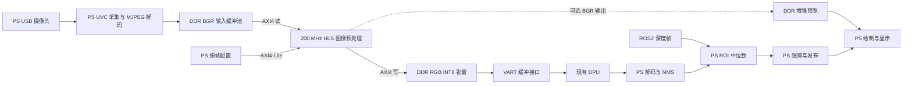

# KV260 DPU 图像处理加速核设计方案

日期：2026-10-13。本文基于工作区现有 Python、Vitis 链接配置、Vivado Block Design 和历史实现报告编写。

**结论：方案可行，推荐 Vitis HLS 2022.1、200 MHz、单像素流水线、AXI4 Master 直接读写 DDR、AXI4-Lite 按帧配置。AXI DMA 不是必需组件。** 首期实现完整的 YOLO 输入预处理以及亮度、对比度、饱和度、全局直方图均衡。应用内的检测后处理、深度采样和跟踪纳入整体设计，但分阶段决定是否独立硬件化，不能把“支持整个应用”当作“所有 Python 操作都在一个像素核中运行”。

本文是设计规格与实施路线，尚未实现 HLS 核、运行 C/RTL 仿真或生成新 bitstream。以下吞吐量为分析值、资源范围为预算，均不是新增核的综合结果。

## 1. 已核实的工程基线

| 项目 | 已核实内容 |
| --- | --- |
| 芯片 | `xck26-sfvc784-2LV-c` |
| 工具 | Vivado/Vitis HLS 2022.1；本机存在 `ap_int.h`、`hls_stream.h` |
| DPU | 一个 `DPUCZDX8G_1`；源码配置 B4096、URAM_ENABLE、DSP48_USAGE_HIGH |
| 其他核 | `sfm_xrt_top_1`，约 100 MHz；不等同于 YOLO sigmoid/NMS 加速器 |
| RGB 输入 | Astra UVC，`cv2.VideoCapture(..., CAP_V4L2)`，请求 MJPG，默认 640×480@30 |
| 深度输入 | OpenNI2/ROS2，默认 320×240@30，`16UC1`，单位 mm |
| 推理接口 | `pynq_dpu.DpuOverlay`，`runner.execute_async()` / `wait()` |
| 模型输入 | Python 常量 416×416；实际 shape、dtype、fix_point 必须从加载模型后的 tensor 再校验 |
| 当前调度 | 显示线程和推理线程分离；单元素最新帧队列；RGB/深度时间差默认允许 50 ms |

代码文件头曾描述 RGB 来源替换，但实际运行的 `open_color_camera()` 与 `main()` 仍直接读取 UVC RGB；深度由 ROS2 提供。设计以执行路径为准。请求 MJPG 不保证设备协商成功，板端需读取实际 FOURCC；当前 `cap.read()` 给后续流程的是 BGR 像素，MJPEG 解码由采集后端承担。

### 1.1 时钟选择

| Clock Wizard 输出 | 平台 clock id | 平台标注 Hz | 名义频率 | 当前 BD 用途 |
| --- | --- | --- | --- | --- |
| `clk_wiz_1/clk_out1` | 0 | 99999000 | 100 MHz | sfm、部分互联 |
| `clk_wiz_1/clk_out2` | 1 | 149998500 | 150 MHz | 对应复位控制器 |
| `clk_wiz_1/clk_out3` | 2 | 199998000 | 200 MHz | 对应复位控制器；推荐图像核 |
| `clk_wiz_1/clk_out4` | 3 | 299997000 | 300 MHz | DPU aclk、已连接的 HP/HPC 端口 |
| `clk_wiz_1/clk_out5` | 4 | 399996000 | 400 MHz | 对应复位控制器 |
| `clk_wiz_1/clk_out6` | 5 | 599994000 | 600 MHz | DPU ap_clk_2 |

100/150/200 MHz 都足以覆盖 640×480@30 的基础像素计算量。首选 200 MHz 是为了给双遍均衡、访存停顿和后续 1080p 留余量，同时避免给已有 DPU 布线增加过高时序压力。600 MHz 是 DPU 的专门计算时钟，不能据此认为任意 HLS 图像流水线都能运行在该频率。

核时钟接 `clk_out3`，低有效复位接 `proc_sys_reset_2/peripheral_aresetn`。互联使用对应的复位与时钟；PS 控制域、已有 300 MHz 数据域与 200 MHz 核之间由 AXI Clock Converter 或支持跨时钟的互联处理，不能直接混接，也不能用宽泛的 false path 掩盖未处理的跨域。

历史 routed timing report 只保留 100/300/600 MHz 等实际使用时钟，未使用输出可能在实现中被优化。新增 200 MHz 消费者后必须重新生成并核查时钟，不能只修改 HLS 时钟参数。

HLS 初始约束：目标周期 5 ns，时钟不确定度显式设置为 0.625 ns，作为首轮综合的保守预算；以综合调度和最终实现报告调整。若集成后时序失败，优先检查关键路径和布局，再考虑 150 MHz，并同步重做 HLS 与链接时钟配置。

### 1.2 资源与时序边界

以下来自 **2026-08-08 的现有 routed 报告**，不是本次重新实现的结果：

| 资源 | 已用 / 总量 | 账面剩余 |
| --- | --- | --- |
| LUT | 63,783 / 117,120 | 53,337 |
| FF | 116,260 / 234,240 | 117,980 |
| BRAM Tile（36 Kb 等价） | 100 / 144 | 44 |
| URAM | 46 / 64 | 18 |
| DSP | 724 / 1,248 | 524 |

报告还显示 CLB 占用位置为 14,333/14,640，约 97.90%。这不表示 LUT 已耗尽，但说明现有逻辑分布广，不能仅凭剩余 LUT 断言易于放置。最差 WNS = **0.011 ns**、TNS = 0，原工程时序通过但裕量很小。新增核必须完整 place/route 并复查 DPU 时钟域。

首期整个新增子系统（核、互联、FIFO、控制）预算目标：LUT ≤15k、FF ≤20k、DSP ≤48、BRAM Tile ≤20、URAM = 0。这些是控制设计规模的目标，若综合超标需重新权衡；不保证最终资源。不要把剩余 BRAM/URAM 全部分配给图像核。

## 2. 应用算法清单及硬件划分

| 算法或操作 | 当前行为 | 设计归属 |
| --- | --- | --- |
| USB/UVC 采集、MJPEG 解码 | PS USB、OpenCV 后端 | 首期保留 PS；像素核不接收压缩 JPEG |
| 深度消息解析、大小端与 stride 处理 | ROS2 `16UC1` 数据 | PS；可给后续独立深度核提供连续缓冲区 |
| 等比例双线性缩放 | `cv2.INTER_LINEAR` | 首期 HLS |
| Letterbox 灰色填边 | 像素值 128，居中 | 首期 HLS |
| BGR→RGB | 交换通道 | 首期 HLS，接线重排 |
| 归一化、INT8 量化 | `/256 * 2^fix_point`，round、clip | 首期 HLS，256 项 LUT |
| 亮度调节 | 当前应用没有 | 首期新增，可旁路 |
| 对比度调节 | 当前应用没有 | 首期新增，可旁路 |
| 饱和度调节 | 当前应用没有 | 首期新增，可旁路 |
| 全局直方图均衡 | 当前应用没有 | 首期新增，亮度通道均衡 |
| CLAHE、Gamma、去噪、锐化 | 当前所查流程没有 | 不属于本次必须算法；以后按需求扩展 |
| YOLO 神经网络计算 | 已编译 xmodel | 原有 DPU |
| INT8 输出反量化、sigmoid、objectness 过滤 | 先筛 objectness，再计算候选类别 | 首期 PS；可独立设计后处理核 |
| 类别 argmax、分数阈值、exp、anchor 解码 | 13/26/52 三尺度，每位置 3 anchors、80 类 | 首期 PS；后续独立后处理核 |
| 按类别排序、IoU、NMS | 阈值默认 0.60 | 首期 PS；后续有界候选核，溢出需回退 |
| 框坐标还原、裁剪 | 减 padding、除 scale、clip | 首期 PS，计算量较小 |
| 深度 ROI、无效值过滤、中位数 | 中心 ROI；`0 < depth <= 10000` 默认条件 | 首期 PS；后续独立深度核 |
| 检测跟踪、IoU 匹配、框/分数平滑、预测保持 | 跨帧状态机 | 首期 PS |
| 画框、字体、状态条、显示、保存 JPEG | OpenCV | 首期 PS；框绘制可另行扩展 |
| ROS 发布、JSON、时间同步、线程调度 | 应用逻辑 | PS |

“支持所有算法”在本方案中意味着整个应用处理链继续可用，且每个算法都有明确执行位置。若要求表中全部计算进入 PL，则需要输入预处理、YOLO 后处理、深度统计、绘图等多个功能块，不应承诺用一个简单流式核完成全部功能。特别是深度 ROI 依赖检测框，必须在 DPU 和后处理之后运行。

## 3. 数据搬运与系统架构

### 3.1 推荐：HLS m_axi + s_axilite



USB 控制器属于 PS，图像首先由驱动放入系统内存；不能把 PS USB 数据直接当成 PL AXI4-Stream。HLS `m_axi` 接口本身生成总线主机，可发起突发读写，因此不需要额外 AXI DMA。

建议初始配置为独立的 128-bit 输入、输出 AXI bundle：`gmem_in`、`gmem_out`，内部用 24-bit BGR/RGB 像素流。128 bit 与 PS HP 端口匹配；它是 DDR 打包宽度，并不意味着像素流水线每周期处理 16 个像素。RGB888 跨 16-byte word 的像素通过字节拼接器处理。

现有连接：

- DPU `M_AXI_GP0` → PS `S_AXI_HPC0_FPD`。
- DPU `M_AXI_HP0` → PS `S_AXI_HP0_FPD`，与 sfm 共享该端口互联。
- DPU **`M_AXI_HP2` → PS `S_AXI_HP1_FPD`**，不要由 DPU 端口名称误判 PS HP2 已占用。
- 当前 BD 的平台属性仍公布 `HP2`、`HP3`、`HPC1`；顶层尚无这些数据接口的已用连接。

优先规划图像读 → HP2、图像写 → HP3。连接前检查原始平台/XSA 是否允许 Vitis 启用这些 PS 接口；必要时在源平台打开端口、连接时钟并重新导出，不能仅凭 PFM 标签认为物理端口已经就绪。HP2/HP3 可配置在核的 200 MHz 域，避免新路径额外跨域；最终由 BD 验证确认。若只能共享现有 HP 端口，则保留原端口时钟、加跨域互联并测试 DPU 并发性能。

控制由 PS `M_AXI_HPM0_LPD` 经控制互联到核 `s_axi_control`；分配无重叠地址，中断接可用中断输入并更新元数据。HP 端口不提供自动 CPU cache 一致性；HPC 也只有在事务属性、互联和软件驱动共同正确配置时才可能实现一致性。

### 3.2 AXI DMA 适用的替代方案

如果选择 `axis` 输入输出，则数据路径为 DDR → AXI DMA MM2S → HLS AXI4-Stream → AXI DMA S2MM → DDR，仍需要 AXI4-Lite 配置 DMA 和图像核。

这适合已经有 AXIS 视频流水线或 PYNQ DMA 软件接口的工程，但会增加 DMA 实例、控制和帧边界管理。首期已有帧存于 DDR、又需要双遍直方图，直接 `m_axi` 更自然。DMA 不会消除 USB、解码或 Python 端已有拷贝。

若采用 DMA，必须明确协议：通用 DMA 的 S2MM `TLAST` 对应传输包结束；AXI4-Stream Video 常用 `TLAST` 表示行结束、`TUSER` 表示帧开始，两者不能不经适配直接混用。还需处理输入输出不同字节数、`TKEEP`、反压、先启动接收、防死锁和 stride。二维视频帧可考虑 VDMA/Video Frame Buffer IP，但本次不默认引入。

## 4. 首期像素核的算法定义

### 4.1 模式与固定顺序

提供 `TENSOR_ONLY`、`PREVIEW_ONLY`、`TENSOR_AND_PREVIEW` 三种输出模式；推理可独立选择原图或增强图，预览始终可选择增强图。默认所有增强旁路，首先对齐现有应用。

固定增强顺序：输入 BGR → 亮度/对比度 → 饱和度 → 可选亮度直方图均衡 → 增强 BGR。推理分支随后执行双线性 resize → 灰色 128 填边 → RGB → INT8 LUT。固定顺序避免实现任意排列的交叉开关，也让结果可复现。

预览分支在 resize 之前输出原分辨率 BGR。若只需要改善画面、不希望改变模型输入分布，可让推理分支从增强前的 BGR 分流；多个消费者必须通过显式复制进程，禁止两个进程竞争读取同一个 HLS stream。

### 4.2 亮度与对比度

定义每通道 `c` 的变换为：

`c1 = sat_u8(round_even(alpha * (c - 128) + 128 + beta))`

- `alpha` 对比度范围初定 [0, 4]，默认 1；主机传无符号 Q3.12 整数编码。
- `beta` 亮度范围 [-255, 255]，默认 0，单位为 8-bit 像素级。
- 固定以 128 为中心，亮度是加法偏移，不宣称等价于相机曝光或任何未定义的 OpenCV API。
- 主机在参数变化时计算 256-byte LUT，核按帧加载。这样没有逐像素浮点或除法，默认 LUT 为恒等映射。
- 三通道每周期要进行 3 次查表，复制 3 份小 LUT 或提供足够读端口；仅一个双口 BRAM 不足以保证三路同时读取。

### 4.3 饱和度

采用基于亮度的 RGB 线性插值，避免 HSV 的 max/min、除法和色相分段逻辑：

`Y = (77*R + 150*G + 29*B + 128) >> 8`

`c2 = sat_u8(round_even(Y + s * (c1 - Y)))`

`s` 范围 [0, 2]，默认 1，使用 Q2.12 无符号整数编码。`s=0` 为灰度，`s=1` 恒等，`s>1` 增强颜色。该饱和度定义不等同于 HSV 的 S 通道缩放；软件参考必须采用同一公式。明确保留有符号差值和乘积宽度，避免无符号下溢；乘加中间值至少采用经范围分析后的 25-bit 有符号数。

### 4.4 直方图均衡

首期是**全局亮度直方图均衡**，不是 CLAHE，也不是 R/G/B 三通道分别均衡。亮度定义沿用上式。用近似 BT.601 full-range 的定点色差保色：

- `Cb = sat_u8(round_even(128 + (-43*R - 85*G + 128*B)/256))`
- `Cr = sat_u8(round_even(128 + (128*R - 107*G - 21*B)/256))`
- LUT 得到 `Yeq` 后，恢复 `R = sat_u8(round_even(Yeq + 359*(Cr-128)/256))`。
- `G = sat_u8(round_even(Yeq - (88*(Cb-128)+183*(Cr-128))/256))`。
- `B = sat_u8(round_even(Yeq + 454*(Cb-128)/256))`。

这是自定义固定点规范，需独立参考实现，不宣称逐位等价于 OpenCV 的 YCrCb 转换。均衡关闭时直接旁路整组变换，避免不必要的往返误差。饱和度或均衡导致的溢出均明确裁剪至 [0,255]。

统计亮度直方图 `hist[256]` 和累计 `cdf[256]`，令 `cdf_min` 为第一个非零累计值，`N` 为有效图像像素数：

`LUT[y] = clip(round_even(255 * max(cdf[y]-cdf_min, 0) / (N-cdf_min)), 0, 255)`。

当 `N == cdf_min` 时使用恒等 LUT（常量图）；非法空图在入口拒绝。为最大 1920×1080 帧，bin 与 CDF 的计数位宽至少 21 bit，首期可用 32 bit 简化；CDF 乘 255 的中间数使用 64 bit 避免扩展分辨率后溢出。除法只在每帧 256 项 LUT 构建阶段使用，可以共享一个多周期除法器，不需要每像素除法器。

必须显式提供两种语义：

| 模式 | 实现 | 代价与行为 |
| --- | --- | --- |
| `EQ_CURRENT` | 第一次读当前原图，执行亮度/对比度/饱和度并统计；生成 LUT；第二次读同一原图，以同一参数重算并应用 LUT | 同帧精确统计，增加一次输入帧 DDR 读取；首期默认均衡模式 |
| `EQ_PREVIOUS` | 本帧应用上一帧 LUT，同时统计本帧；下一帧切换 LUT bank | 单遍，第一帧恒等；场景突变时滞后一帧，不等价于当前帧均衡 |

两遍处理期间主机不得覆盖源帧、配置和 LUT 缓冲区。采用重读原图避免缓存整帧增强结果。上一帧模式在分辨率、颜色参数、模式改变及相机重启时重置历史状态；仅在帧边界切换 LUT。统计实际图像，不把 letterbox 灰边计入分布。

`hist[Y]++` 有真实读改写相关性，连续相同亮度尤其容易出错。不能简单加 `DEPENDENCE inter false` 来声称 II=1。初版优先保证正确性，允许统计阶段 II>1；优化可用最近更新值前递，或轮转访问多个独立 histogram bank，使同一 bank 的更新间隔覆盖实际 RAM/加法流水线延迟，帧末再合并。bank 数必须按综合延迟确定。使用纯色帧验证最坏冲突。

### 4.5 Resize、Letterbox 与量化兼容性

必须复现 `infer_yolov4.py` 的约定：

1. 主机计算 `scale=min(416/W,416/H)`，使用 Python `round` 得到 `resized_w/resized_h`，计算左上 padding，并把整数几何参数传给核；框还原继续使用原来的浮点 scale。
2. 默认 640×480 → 416×312，`pad_x=0`、`pad_y=52`，上下各 52 行，padding 像素是 **128**，不是常见的 114。
3. 双线性坐标按 OpenCV half-pixel 映射 `x=(dx+0.5)*W/resized_w-0.5`，边缘做边界复制；纵向同理。系数位宽、系数量化、水平/垂直舍入必须通过板端所用 OpenCV 版本的 golden output 确认。
4. 不能把 `INTER_LINEAR` 换成 nearest、area 或假定任意库的 bilinear 都逐位相同。首期限定输入 W/H 均不小于目标 416×416、最大 1920×1080，仅执行缩小或恒等；更小输入显式回退 PS，后续再扩展上采样调度。1920×1080 的输出为 416×234，上下各 91 行。
5. 填边后 BGR→RGB，输出 NHWC、连续 RGB INT8 字节，目标 shape 为 `[1,416,416,3]`。当前模型若报告不同布局/shape，拒绝静默运行。
6. 量化为 `q=clip(round_even(pixel * 2^(fix_point-8)), -128,127)`。不是 `/255`、不是减 128，也不是简单截断。
7. 首期由主机完全按现有 NumPy 公式生成 256 项 INT8 LUT，模型加载或 fix_point 改变时更新；核每通道查表。`fix_point=6` 只是源码注释中的示例，实际取 tensor 属性。
8. 以 `fix_point=6` 为例，像素 2→0、6→2、10→2、128→32、255→64。普通 `(pixel+2)>>2` 不满足最近偶数规则。

Resize 使用行缓存和横向邻域寄存器；预算至少两行，具体双口 RAM/乒乓结构由输入消费与输出产生调度决定。缩小时每一条输入行仍须消费，包括未用于输出的行；上下灰边也会占用输出周期，不能宣称输入输出在整帧中始终同时一像素/周期。DMA 反压或 DDR 写阻塞时，所有流水级必须可停顿。

最大两行 BGR 存储为 `2*1920*3=11,520 bytes`。不能把 640×480 的 921,600-byte 整帧数组自动综合到片上 RAM：仅该帧就约需 200 个 BRAM36 的原始容量，已超过芯片总 BRAM 容量。

## 5. HLS C/C++ 分解与约束策略

实现采用 HLS C++ 的静态数组、`ap_uint/ap_int`、`hls::stream`；这是适合 Vitis HLS 的 C/C++ 硬件描述方式。动态分配、递归、OpenCV、Python、文件 I/O 不进入可综合代码。OpenCV/NumPy 只用于主机或仿真参考。本机未在已检查目录确认安装 Vitis Vision 库，因此首期设计不依赖未经确认的 `xf::cv` API；若以后采用，先锁定与 2022.1 匹配的库版本及具体算子的行为。

### 5.1 顶层与子函数职责

顶层建议名 `image_preprocess`，采用帧任务控制，顶层每次调用只处理一帧：

| 子函数 | 职责 | 主要数据结构 |
| --- | --- | --- |
| `validate_and_load_config` | 校验尺寸、stride、容量、地址、输出模式；加载本帧 LUT | 小寄存器、LUT banks |
| `read_bgr_bursts` | 按行读取 128-bit DDR words，解包 BGR888 | 小型 burst FIFO、字节拼接寄存器 |
| `adjust_color` | 亮度/对比度 LUT、定点饱和度 | 24-bit 像素流、定点中间值 |
| `collect_histogram` | 可选第一次遍历或上一帧统计 | 256-bin histogram |
| `build_equalize_lut` | bank 合并、CDF、256 项映射 | 计数 RAM、双 bank LUT |
| `apply_equalize` | 可选 Y/Cb/Cr 映射和重建 | 24-bit 像素流 |
| `split_outputs` | 明确复制到推理/预览路径，支持原图推理选择 | 独立 FIFO |
| `resize_bilinear` | 缩小、行缓存、边界处理 | 分 bank 行缓存、邻域寄存器 |
| `letterbox_quantize` | 128 填边、RGB 重排、量化 LUT | 3 份量化 LUT、24-bit 张量流 |
| `write_tensor_bursts` | 字节重打包、写 NHWC INT8 | 128-bit stream、DDR writer |
| `write_preview_bursts` | 可选原尺寸增强 BGR 输出 | 小 FIFO、DDR writer |

`EQ_CURRENT` 顶层调度为：加载配置 → 第一遍统计 DATAFLOW → 构建 LUT → 第二遍输出 DATAFLOW。统计和应用之间有整帧依赖，不能把三者当作无依赖流级并发执行。关闭均衡时只有输出遍历；`EQ_PREVIOUS` 采用双 bank，读旧表、统计新帧。

输出模式在帧开始固定。不要让顶层 DATAFLOW 包含随像素改变的拓扑分支；用固定阶段内旁路、固定计数或单独的静态 dataflow 函数实现模式。预览关闭时，禁用对应分流或持续消费并丢弃其 token，避免写满无消费者 FIFO。

### 5.2 指令与预期作用

以下指令是拟实施的约束，不代表已经证明达到 II 或资源预算：

| 指令/配置 | 应用位置 | 约束与取舍 |
| --- | --- | --- |
| `INTERFACE m_axi ... offset=slave bundle=gmem_in` | 输入帧、输入配置表 | 128-bit 字类型；顺序访问才能形成有效 burst |
| `INTERFACE m_axi ... offset=slave bundle=gmem_out` | 输出张量、预览、结果元数据 | 先共用输出 bundle；若仲裁明显阻塞再考虑拆分 |
| `INTERFACE s_axilite ... bundle=control` | 地址与每个标量参数、return | 地址通常为 64-bit 参数；实际偏移以导出的寄存器头文件为准 |
| `DATAFLOW` | 独立的一次完整像素遍历 | 让读取、变换、写出重叠；不跨越当前帧均衡的 LUT 屏障 |
| `PIPELINE II=1` | 解包、颜色、查表、打包等像素循环 | 作为目标；统计与 resize 依据真实相关性独立报告 II |
| `UNROLL` | 固定 3 通道或小邻域循环 | 不展开整行/整帧，避免复制大量运算器 |
| `ARRAY_PARTITION ... complete dim=1` | 行缓存的“行 bank”维度、小通道数组 | 不完整分割 1920 宽像素维度 |
| `BIND_STORAGE ... type=ram_2p impl=bram` | 行缓存 | 配合 bank 划分与访问调度保证端口足够 |
| `BIND_STORAGE ... type=ram_2p impl=lutram` | 小型可写 LUT | 根据复制数和实际综合选择；不能把运行时可写 LUT 声明成 ROM |
| `STREAM ... depth=64` | 普通级间 FIFO 的初始深度 | 64 是起点，以 RTL cosim 的占用、反压、死锁报告调整 |
| `INLINE off` | DATAFLOW 的主要 stage | 保留任务边界；简单数值辅助函数可 INLINE |
| `LOOP_TRIPCOUNT` | 运行时 W/H、burst 循环 | 改善延迟估计，不改变硬件吞吐，也不代替边界检查 |
| `ALLOCATION` | LUT 构建等非关键阶段 | 限制除法/乘法实例以节省资源；不可误约束像素关键路径 |
| `BIND_OP ... op=mul impl=dsp` | 确认是瓶颈的变量乘法 | 结合报告使用；常数乘法可由移位加法实现，不一律强制 DSP |

初始 AXI 参数可选最大 burst 32 beats、读写 outstanding 各 4。每个 128-bit burst 是 512 bytes；提高 outstanding 会增加缓存资源，先测量再放大。不能默认 512-bit 总线一定优于 128-bit，也不要把单个字节的随机访问写成顶层访存循环。

RGB888 行 stride 与 16-byte word 边界可能不对齐。首期要求输入缓冲区起始地址 64-byte 对齐、stride 为 16 的倍数且 ≥3W，主机必要时按行拷贝；缓冲区包含行尾 padding。输出缓冲区按总字节数向上取整到 16-byte 边界，尾 word 未用 byte 填零，调用方只消费有效长度。预览同样使用对齐 stride。默认 640 宽的 1920-byte stride 与 416 宽的 1248-byte 张量行均符合要求。

若将来支持紧密排列的任意宽度，必须增加跨行拼接和尾写规则，避免读取越界或覆写相邻缓冲区。所有宽高乘法/地址偏移先扩展到 64 bit 再算；HLS 仿真接口 `depth` 也要覆盖最大对齐分配容量。

### 5.3 运行时寄存器与帧原子性

| 参数组 | 内容 |
| --- | --- |
| 控制 | start/done/idle、interrupt enable/status、ABI version |
| 输入 | src_addr、width、height、src_stride、src_capacity、format（首期 BGR888） |
| 张量输出 | tensor_addr、tensor_capacity、目标 416×416、resized_w/h、pad_x/y |
| 预览输出 | preview_addr、preview_stride、preview_capacity、output_mode |
| 增强 | enable bits、增强是否用于推理、eq_mode、历史重置位 |
| 查找表 | color_lut_addr、quant_lut_addr、参数版本；饱和度 Q2.12 编码 |
| 同步 | frame_id、config_id |
| 结果 | status/error_code、完成帧 id、完成配置 id、有效字节数、cycle_count |

主机的亮度/对比度滑块先生成新的 color LUT；量化表来自模型 fix_point。核不在运行中直接读取持续变化的主机 LUT。首期每帧启动前写寄存器，busy 期间禁止修改，关闭 auto-restart；核入口加载本帧所有参数与 LUT 到本地后才处理数据。这样实时调节在下一帧生效，不会出现同一帧上半部分和下半部分配置不同。

后续若需要主机与核并行提交多帧，升级成双缓冲描述符和配置 bank，使用 frame_id/config_id 追踪，不依赖“写 AXI-Lite 就会自动锁存所有参数”的假设。硬件返回错误状态，主机设超时；非法尺寸、容量、模式不得继续发出越界 AXI 请求。多个软件线程统一经同一核管理器调度。

## 6. PS 软件接入与内存管理

### 6.1 最小可验证接入

替换 `run_dpu_inference()` 中 `letterbox_image()` 与 `quantize_input()` 两步，后面的 DPU、decode、NMS、深度、跟踪先保持原行为。

1. 模型加载后读取输入 tensor shape、dtype、fix_point；构建量化 LUT，检查硬件 ABI。
2. 使用已验证的 PYNQ 连续缓冲区分配接口或 XRT BO 建立输入、输出和 LUT 缓冲池，复用分配，不每帧新建。
3. `cap.read()` 的普通 NumPy 缓冲区通常不能直接作为 PL 可用物理地址。首期允许一次 BGR→可访问缓冲区拷贝；不得传 Python 虚拟地址给 `m_axi`。
4. CPU 写输入与 LUT 后按分配器/驱动要求 flush 或 sync-to-device；完成后先等待核，再按使用者要求 invalidate/sync-from-device。
5. 让 HLS 输出以正确 NHWC INT8 视图传入现有 runner；最小接入可以经 CPU 可见数组或明确拷贝。记录 VART 是否再次拷贝，不能仅因传了 PYNQ buffer 就宣称零拷贝。
6. 保留 scale/padding/frame_id 对应关系，使用原深度帧与时间戳；处理失败按配置回退原软件预处理并记录错误。

现有 `dpu_time` 只测 `execute_async()` 和 `wait()`，不包含 letterbox、量化、decode、NMS。预处理硬件化后该指标可能几乎不变；它也可能包含 runner 内部数据搬运，不能直接当作纯 DPU 运算时间。

### 6.2 进一步减少拷贝

理想路径是解码后的 DMA-BUF/BO → HLS → DPU 可导入的 TensorBuffer；是否可行取决于板端 UVC/解码器、PYNQ、XRT、VART 版本和支持的导入 API。当前 Python runner 接口不足以证明这些条件已满足。需要在板端查询并验证 BO/device address、TensorBuffer 的 location 和同步方法；必要时用 C++ VART 包装，而非臆造 Python 共享接口。

PS/PL/DPU 每次交接都有缓冲区所有权：CPU_DIRTY → PL_READING/WRITING → READY_FOR_DPU → DPU_INFLIGHT → FREE。设备写出的结果不能被随后一次 CPU flush 的旧缓存覆盖。普通 HP 路径以驱动提供的同步操作为准。

采用 2～3 个槽位流水化采集、HLS、DPU，前提是 runner 允许相应并行度。沿用“最新帧优先”，只丢弃未提交的旧帧，不能复用仍在 PL/DPU 访问的缓冲区。输入帧在 `EQ_CURRENT` 第二遍完成前不可归还；输出张量在 runner 完成前不可覆盖。深度帧需要匹配 frame_id 的寿命管理。

当前软件已经使用量化 LUT，且 decode 已先过滤 objectness；因此不能把“消除每帧大量量化 float 数组”或“首次避免全部类别 sigmoid”当作新增收益。主要收益来自融合 resize/增强/量化、减少中间图像和重复拷贝。保留预览、ROS 发布和深度会继续消耗 CPU 与内存；RSS 未必按像素核吞吐同比下降。

## 7. 性能估算与测量方法

### 7.1 计算量和 DDR 流量

默认输入 `640*480*3 = 921,600 bytes`，模型输入 `416*416*3 = 519,168 bytes`。

| 场景 | 图像核每帧 DDR 有效读写总量 | 30 fps 时有效流量 |
| --- | --- | --- |
| 单遍、只输出张量 | 1,440,768 bytes | 43.223 MB/s |
| 当前帧均衡、双读输入、只输出张量 | 2,362,368 bytes | 70.871 MB/s |
| 当前帧均衡、张量加增强预览 | 3,283,968 bytes | 98.519 MB/s |

这是十进制 MB/s，仅包含图像核 payload；不含输入 CPU 拷贝的读写、缓存维护、USB/MJPEG、原始/结果 ROS 图像、DPU 权重与特征图、AXI 协议开销。独立 HP2/HP3 仍共享最终 DDR 控制器，不能等同独立物理内存。

200 MHz、II=1 理想条件下，读取 640×480 像素需要 1.536 ms 像素时钟预算，输出 416×416 需要 0.865 ms。若完全不重叠，两者合计 2.401 ms；真实流水线可重叠，但还有行缓存、灰边、LUT、DDR 与控制开销。双遍均衡再增加一次扫描；统计 II>1 时按实际周期增加。因此这些数值既不是完整帧实测延迟，也不是固定的上下界。

1920×1080@30 = 62.208 Mpixel/s；双遍扫描至少 124.416 Mpixel/s，再加输出/停顿。200 MHz 单像素结构在理想吞吐上有空间，但 histogram 相关性和访存会影响能否达标，不能提前保证 1080p30。首期验收重点为当前 640×480@30。

2 个默认尺寸输入缓冲区加 2 个张量缓冲区有效容量共 2,881,536 bytes；若再有 2 个增强预览缓冲区，总共 4,724,736 bytes。还需加对齐、深度、runner、ROS 和软件显示缓冲区。硬件化并不表示零 DDR 占用，应与现有 Python 分配峰值实测对比。

### 7.2 指标与预期

分别测量采集/解码、输入拷贝/同步、HLS、runner 输入交接、DPU、decode/NMS、深度/跟踪、绘制/发布。报告显示 FPS、推理完成 FPS、采集到结果延迟 P50/P95/P99、丢帧率、CPU 每核利用率、RSS、CMA/BO 占用、板卡温度和功耗。

串行阶段优化受 Amdahl 定律约束：原预处理占总耗时比例 p、加速 k 倍，理论总加速 `1 / ((1-p)+p/k)`，尚未扣除新增传输开销。例如原预处理只占 20%，即使无限加速，整体也至多 1.25 倍。异步流水线吞吐则受最慢阶段限制。DPU 神经网络运算量没有减少；相机 30 fps 也限制独立新帧率。

不能承诺“推理速度一定加快很多”。可合理预期降低部分 CPU 图像运算与中间缓冲压力；幅度必须与现有已经优化的应用进行同条件板端对比。

## 8. 后处理及深度算法扩展设计

如果 profiling 显示后处理主导耗时，可增加独立 `yolo_postprocess`，通过 DDR 读取 3 路 INT8 输出。现有三尺度共 `(52²+26²+13²)*3=10,647` anchors、904,995 个 INT8 输出元素。

- 每个输出 fix_point 使用独立 sigmoid/exp 映射表或经误差分析的定点实现，严格对应 sigmoid 输入 [-30,30]、exp 输入 [-10,10] 的裁剪。
- 先读 objectness 并过滤，再读候选类别；对 80 类做最大值、分数阈值和框解码。布局必须与真实 DPU 输出契约一致。
- NMS 支持类别内排序、IoU 与阈值语义。设置候选容量时提供 overflow 状态并回退 CPU；不能静默 top-K 截断却声称完全等价。
- 同分排序、浮点/定点边界和阈值附近误差可能改变输出框，需确定稳定排序和误差验收标准。

深度可独立设计 `depth_roi_stats`：接收 16-bit 深度、stride、N 个框和颜色/深度尺寸，复现 floor/ceil、边界裁剪、中心 20% margin、有效值过滤、数量统计和中位数。偶数个有效值需返回中间两个的平均值，可以保留 0.5 mm；没有有效像素则明确返回 invalid。

中位数不是平均值，也不是只取中心像素。可在固定深度范围内用粗细两级 histogram 加重复扫描或精确选择算法，但必须有有限 ROI 容量、动态最大深度支持边界和资源预算。先按 PS 测量判断 ROI 统计是否值得增加硬件，不默认分配大型直方图占满剩余 BRAM。

当前 RGB/深度对应关系只是归一化坐标映射，没有标定配准。硬件加速不会提高其几何准确性；若要准确对齐，需要另行标定、投影与遮挡处理算法。

## 9. 工程集成路线

不把 Vitis 生成的临时 `vpl/prj` 作为唯一长期源码。该目录适合检查结果和临时验证，但重新链接会重建文件。建议 HLS 源码、testbench、构建 Tcl、golden vectors、软件适配器放在独立受版本管理的源码目录；本设计文档放在 `/home/amd/Workspace/dpu_platform2/IMAGE_PREPROCESS_HLS_DESIGN.md`，避免被链接清理。

优先以 HLS kernel `.xo` 参与现有 Vitis 链接，保留 DPU/sfm 定义。在确认导出 kernel 实例名和 AXI bundle 名后，拟增加以下配置项（合并到现有同名 section，而非覆盖原配置）：

```ini
[clock]
id=2:image_preprocess_1.ap_clk

[connectivity]
nk=image_preprocess:1:image_preprocess_1
sp=image_preprocess_1.m_axi_gmem_in:HP2
sp=image_preprocess_1.m_axi_gmem_out:HP3
```

这是拟采用的 kernel 命名契约，实际链接前核对导出的 `kernel.xml` 和平台可用 memory tags。保留原 DPU `id=3` / `id=5` 映射及全部既有 connectivity；如果最终导出的 AXI 名称不同，同步修改配置。

也可导出 Vivado IP 并通过可复现 Tcl 添加到 BD，适合继续用 PYNQ MMIO 驱动。采用这条路线必须保存插入脚本并集成到构建流程，不能只在 GUI 临时工程中手动连线。对于同一个 kernel，选择 XRT 调度或直接 MMIO 的明确所有者，避免两个软件栈同时控制。

硬件更新后同步部署匹配的 bitstream、HWH、xclbin（若运行时需要）、地址/中断元数据及必要的设备树。保留现有 DPU 配置和模型兼容性检查；若改变 DPU 架构/fingerprint，必须重新核实模型编译目标。不能仅复制新 `.bit` 而继续使用旧地址描述文件。

## 10. 实施阶段与验收

1. **板端基线**：确认 FOURCC、软件版本、模型张量、分阶段耗时、实际内存和 CPU；保存固定测试帧及现有预处理输出。当前开发主机未提供可直接运行该应用的 ROS2/PYNQ/摄像头环境。
2. **兼容预处理核**：增强默认全旁路，完成 BGR burst 读取、resize、letterbox、RGB、量化与张量写出；先匹配当前 640×480→416×416。
3. **增强模块**：加入颜色 LUT、定点饱和度、`EQ_CURRENT`，再加入 `EQ_PREVIOUS` 和预览分支。首期先以正确统计为主，再优化 histogram II。
4. **HLS 验证**：在 Vitis HLS 2022.1 按顺序运行 `csim_design`、`csynth_design`、`cosim_design`，检查实际 II、burst、FIFO、latency、DSP/BRAM 和死锁。用至少连续两帧覆盖静态状态与 LUT 切换。
5. **硬件集成**：导出 `.xo` 或 IP，连接 HP2/HP3 与控制/中断，BD validation、完整 synth/place/route、DRC、timing、CDC 检查。
6. **应用接入**：先保留一次明确拷贝获得正确性，再逐步验证共享 BO/TensorBuffer；用帧 id 和缓冲区状态避免覆盖。
7. **性能验收**：同相机模式、同模型、同显示/ROS 条件对比；随后按数据决定后处理/深度是否进入 PL。

测试矩阵至少包括：

| 类别 | 必须覆盖 |
| --- | --- |
| 基础图像 | 全黑、全白、常量灰、RGB/BGR 色条、棋盘格、渐变、固定种子随机图、真实相机图 |
| 缩放几何 | 640×480、1280×720、1920×1080、宽高奇偶组合、极端长宽比；非法或小于首期下限尺寸拒绝/回退 |
| 量化 | 256 个像素值逐项比较；多组模型允许的 fix_point；最近偶数边界及饱和 |
| 增强 | 默认恒等、alpha=0/1/4、beta 两端、s=0/1/2、参数组合、溢出裁剪 |
| 均衡 | 单 bin、双 bin、均匀分布、连续相同像素、场景切换、同帧两遍一致、上一帧模式复位 |
| 访存 | 对齐/stride、容量不足、行尾 padding、最后一个 word、源目的重叠拒绝、随机 AXI stall |
| 多帧 | 连续帧、配置切换、重启、模式切换、超时恢复、丢帧、CPU/DPU 缓冲区所有权 |
| 端到端 | 框数量、类别、坐标、置信度、检测准确率、深度结果及帧对应关系 |

默认兼容路径的目标是量化 LUT 与填边/通道顺序逐位一致；resize 先争取对当前 OpenCV 版本逐位匹配。若不同插值实现存在 ≤1 LSB 等差异，必须记录实际最大误差和分布，并经过数据集精度与阈值敏感样本验证后才接受，不能只凭视觉一致放行。增强算法对其自定义定点参考逐位一致；增强默认关闭，并用目标场景评估对模型准确率的影响。

集成后要求建立/保持时间与脉宽检查通过，无未解释的时钟/跨域问题，640×480@30 目标模式不因预处理持续积压。最终是否“显著提速和降 CPU/内存”以板端指标为准；若瓶颈是 MJPEG、DPU、NMS 或 ROS 图像发布，继续针对相应阶段优化。

## 11. 核查来源与本次验证范围

以下为本次直接核查的本地来源：

- [应用入口与实时链路](/home/amd/x3plus-kv260-docker/vision-optimization/remote_camera_yolov4.py)：`run_dpu_inference`、`sample_detection_depth`、`DetectionTracker`、`open_color_camera`、`main`。
- [预处理、量化、YOLO 解码和 NMS](/home/amd/x3plus-kv260-docker/vision-optimization/infer_yolov4.py)。
- [Vitis 链接配置](/home/amd/Workspace/dpu_platform2/kv260_vitis_platform2/dpu_trd_system_hw_link/Hardware/dpu-link.cfg)。
- [当前生成的 Block Design](/home/amd/Workspace/dpu_platform2/kv260_vitis_platform2/dpu_trd_system_hw_link/Hardware/dpu.build/link/vivado/vpl/prj/prj.srcs/sources_1/bd/kv260_hardware_platform/kv260_hardware_platform.bd)：device、PFM clocks、nets、interface_nets、AXI tags。
- [DPU 源配置](/home/amd/Workspace/dpu_platform2/kv260_vitis_platform2/dpu_trd_kernels/src/prj/Vitis/dpu_conf.vh)。
- [历史 routed 资源报告](/home/amd/Workspace/dpu_platform2/kv260_vitis_platform2/dpu_trd_system_hw_link/Hardware/dpu.build/reports/link/imp/impl_1_full_util_routed.rpt)。
- [历史 postroute 时序报告](/home/amd/Workspace/dpu_platform2/kv260_vitis_platform2/dpu_trd_system_hw_link/Hardware/dpu.build/link/vivado/vpl/prj/prj.runs/impl_1/kv260_hardware_platform_wrapper_timing_summary_postroute_physopted.rpt)。

本次仅新增设计文档，未修改原应用、BD、DPU 或链接配置。通过静态读取交叉核对算法、时钟/接口、历史资源/时序，并检查文档路径及带宽/尺寸算术；未执行硬件综合、OpenCV 数值回归或板端 FPS 测试。下一阶段实现以本文的接口、数值语义和验证边界为起点。

## 12. HLS 实施进展（2026-10-13）

第 11 节描述的是设计文档编写阶段。后续实施源码现已位于独立目录
`/home/amd/Workspace/HLS_IP/image_preprocess`，包含 HLS C++、独立参考测试、
构建 Tcl、主机 LUT/参数辅助程序、Vivado 插入/验证脚本和资源报告脚本。
复现步骤见 [README](/home/amd/Workspace/HLS_IP/image_preprocess/README.md)，
实测结果与部署边界见 [验证记录](/home/amd/Workspace/HLS_IP/image_preprocess/VALIDATION.md)。

已实现兼容路径、颜色 LUT、饱和度、当前帧与上一帧亮度均衡、三种输出模式、
配置切换和容量校验。24 组正常图像/几何场景与 7 组非法参数通过 C 仿真。
最终五帧 Verilog C/RTL 协同仿真通过，未报告输出失败或 DATAFLOW 死锁，
640×480 当前帧均衡、张量加预览的模拟任务延迟为 5.711195 ms。
Vivado IP 已导出并检查 ZIP、接口与寄存器头文件；未导出 `.xo`。
OpenCV 4.10.0 默认随机帧对比有 2.3663% 张量字节差异，最大差异 1 INT8 LSB；
尚需板端 OpenCV 与数据集精度验收，不宣称 resize 逐位一致。

当前 Vivado 独立 RTL 综合为 13,543 LUT、13,299 FF、11.5 BRAM Tiles、52 DSP、
0 URAM。DSP 比目标多 4；HLS 估计与实际映射数量不同。核级综合 WNS 为
+0.452 ns，未执行与 DPU 合并后的完整布局布线，不代表系统时序通过。

实施与设计的明确差异：预览增加独立 `m_axi_gmem_preview` bundle，因为
Vitis HLS 2022.1 禁止两个 DATAFLOW writer 同写一个 bundle；Vivado 脚本在
SmartConnect 中合并张量/预览至 HP3。ABI 首版通过 AXI-Lite 返回状态、帧/配置 ID
和有效字节数，未提供硬件周期计数器；主机测量启动到完成时间。地址对齐、
源目的重叠和 LUT 缓冲容量由主机验证，硬件入口验证尺寸、stride、启用输出容量、
几何、模式和饱和度。首版采用 polling；完整平台中断接入仍待实施。

Vivado IP 插入脚本已在源平台 BD 的独立副本中执行并通过 BD validation，启用
HP2/HP3，接入 200 MHz 时钟与 reset，生成控制地址和集成 Tcl。原应用、DPU
配置、原 BD 与 Vitis link 配置未修改；源平台中断与 AXI USER/时钟元数据警告
在验证记录中逐项说明。后续仍需要完整硬件实现、配套 HWH/xclbin、板端缓存与
缓冲区所有权接入，以及准确率和 640×480@30 并发性能验证。