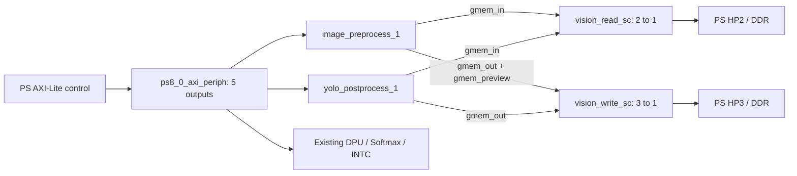

# DPU + image preprocessing + YOLO postprocessing BD integration

The linked Vivado 2022.1 project was updated in place on 2026-10-13:

- Project: `/home/amd/Workspace/dpu_platform2/kv260_vitis_platform2/dpu_trd_system_hw_link/Hardware/dpu.build/link/vivado/vpl/prj/prj.xpr`
- BD: `/home/amd/Workspace/dpu_platform2/kv260_vitis_platform2/dpu_trd_system_hw_link/Hardware/dpu.build/link/vivado/vpl/prj/prj.srcs/sources_1/bd/kv260_hardware_platform/kv260_hardware_platform.bd`
- Integration files: `/home/amd/Workspace/dpu_platform2/bd_accelerator_integration`

## Connections

| Block | Control connection | Address window | Interrupt input |
|---|---|---|---|
| Existing DPUCZDX8G_1 | ps8_0_axi_periph/M01_AXI | 0x80000000–0x80000FFF | 1, unchanged |
| Existing sfm_xrt_top_1 | ps8_0_axi_periph/M02_AXI | 0x80001000–0x80001FFF | 0, unchanged |
| Existing axi_intc_0 | ps8_0_axi_periph/M00_AXI | 0x85000000–0x8500FFFF | PS IRQ, unchanged |
| image_preprocess_1 | ps8_0_axi_periph/M03_AXI | 0x86000000–0x8600FFFF | 2 |
| yolo_postprocess_1 | ps8_0_axi_periph/M04_AXI | 0x86010000–0x8601FFFF | 3 |

The existing PS M_AXI_HPM0_LPD aperture is 0x80000000–0x9FFFFFFF. Both new control windows are inside this aperture. Interrupt numbers above are AXI INTC input positions, not Linux IRQ numbers. The HLS interrupts are high-level inputs; generated HWH reports AXI INTC C_KIND_OF_INTR=0xFFFFFFF0. Software can use polling with HLS interrupt generation disabled.



Both PS HP ports have 128-bit data width. SmartConnect adapts the HLS master widths, including the postprocessor's 256-bit output, to the PS ports. The DPU keeps its existing HPC0, HP0 and HP1 connections. Data exchange with the DPU uses DDR buffers and host scheduling; there is no direct streaming connection between these memory-mapped IPs.

Both HLS cores, SmartConnects, HP2/HP3 clocks and new AXI-Lite master clocks use `clk_wiz_1/clk_out1` (requested 100 MHz; approximately 99.999 MHz from the existing PS reference). Core resets use `proc_sys_reset_0/peripheral_aresetn`; interconnect resets use `proc_sys_reset_0/interconnect_aresetn`. This reset controller's `slowest_sync_clk` uses the same 100 MHz clock. The DPU's 300/600 MHz clocks and the clock wizard's output frequency settings are unchanged.

The 100 MHz migration moves eight clock endpoints and six reset endpoints. The previous integrated BD, XPR, scripts and manifests are archived under the directory recorded in `clock_change_backup_path.txt`. The original `integrated_artifact_sha256.json` is retained as a historical record; `clock100_artifact_sha256.json` records the new artifacts after validation. Lower frequency relaxes vision setup timing but does not establish routed setup/hold closure or reduce the existing RTL's resource count.

Each new memory master maps the PS DDR_LOW aperture (0x00000000, 2 GB) and DDR_HIGH aperture (0x800000000, 32 GB). These are PS address apertures, not a claim that all addresses contain physical RAM. Software must pass valid allocated physical buffer addresses and maintain cache coherency for the noncoherent HP ports. OCM and QSPI are not mapped to the new masters.

## IP sources and backup

The project references immutable copies of the previously exported HLS IP packages under:

- `/home/amd/Workspace/dpu_platform2/bd_accelerator_integration/ip_repo/image_preprocess`
- `/home/amd/Workspace/dpu_platform2/bd_accelerator_integration/ip_repo/yolo_postprocess`

`/home/amd/Workspace/dpu_platform2/bd_accelerator_integration/ip_repo_sha256.json` records their SHA-256 hashes. Subsequent HLS rebuilds do not silently change these project dependencies. Do not remove this integration directory while using the project.

The clock migration retains these existing IP snapshots. The later arithmetic optimizations exported under `/home/amd/Workspace/HLS_IP` have not been imported into this BD by the clock change.

The integration scripts use the fixed snapshot repositories and remove `/home/amd/Workspace/HLS_IP` from this project's `ip_repo_paths`. This eliminates duplicate HLS VLNVs and prevents newer HLS exports from locking the saved BD because of a revision mismatch. The source/export files themselves remain untouched.

The pre-edit project backup is `/home/amd/Workspace/dpu_platform2/bd_accelerator_integration/backups/20261013_053830/original_project.tar.gz`. It contains the original XPR, sources, generated products, cache, runs, hardware directory and IP user files. Existing external DPU/Softmax repositories remain at their original locations. The archive can be inspected or extracted to a separate directory before any recovery operation.

## Validation and generated files

- Isolated BD reconstruction and `validate_bd_design`.
- In-place BD integration and `validate_bd_design`.
- `generate_target all` for the BD, including both HLS cores and SmartConnects.
- Reopening the saved target project in a separate Vivado batch process and validating it again.
- Structural checks against the original BD: original cells, original connections and address maps; new control/memory connections, clocks, resets, interrupts, DDR mappings and exported IP hashes.
- HWH inspection confirms both cores, their control addresses, clocks, resets and interrupt sensitivity.

Reports and exported BD Tcl are under `/home/amd/Workspace/dpu_platform2/bd_accelerator_integration/reports`. Batch logs are in the integration directory. The generated HWH is `/home/amd/Workspace/dpu_platform2/kv260_vitis_platform2/dpu_trd_system_hw_link/Hardware/dpu.build/link/vivado/vpl/prj/prj.gen/sources_1/bd/kv260_hardware_platform/hw_handoff/kv260_hardware_platform.hwh`.

Vivado emits warnings about AXI AWUSER/ARUSER widths, tied-off unused interrupt inputs and propagated fixed-IP clock metadata. DDR HP-port USER width adaptation must still be covered by system validation. These warnings did not block BD validation or output generation. The isolated reconstruction can also report missing original XCI paths while reconstructing those IPs from the BD and IP catalog.

The full design has **not** been resynthesized or placed/routed after this change. Existing `synth_1` and `impl_1` results are stale (`NEEDS_REFRESH=1`); an old `write_bitstream Complete!` status does not describe this updated design. No new bitstream, XSA or XCLBIN is claimed. The original design's high CLB occupancy and narrow timing margin require a new implementation before fit/timing can be confirmed.

## Reopening and repeating checks

Open the XPR above to inspect the updated BD. If an older GUI session holds a stale design, close it without saving and reopen the project. The updated BD contains `image_preprocess_1`, `yolo_postprocess_1`, `vision_read_sc` and `vision_write_sc`.

Verify the saved design without reinserting IPs:

```sh
/tools/Xilinx/Vivado/2022.1/bin/vivado -mode batch -source /home/amd/Workspace/dpu_platform2/bd_accelerator_integration/scripts/run_integration.tcl -tclargs verify
python3 /home/amd/Workspace/dpu_platform2/bd_accelerator_integration/scripts/check_saved_bd.py
```

`run_integration.tcl check` reconstructs the backed-up original BD in an isolated project and repeats insertion. `apply` is for the original, unmodified target BD only and rejects duplicate insertion. `prepare` regenerates products and creates missing synthesis runs for an already integrated project, without launching synthesis. `integrate_accelerators.tcl` is the reusable insertion script; `reports/verify/integrated_bd.tcl` exports the resulting complete BD.

`run_integration.tcl clock100` migrates an already integrated BD to 100 MHz, validates and saves it, and regenerates output products without launching implementation. It is safe to repeat. Both migration and fresh insertion use `scripts/connect_vision_100mhz.tcl`, so future insertion also connects the vision subsystem to 100 MHz. Clock migration reports are in `reports/clock100/`; the console log is `clock100.console.log`.

This is a modification to a generated Vitis link project. A fresh Vitis link can recreate that project and remove manual BD additions. Preserve the integration directory and reapply the insertion script to a regenerated original BD, or incorporate it into the future link/platform build flow.

The new cores are ordinary AXI-Lite peripherals, not automatically registered XRT compute units. Application adapters, device-tree/driver access, host buffer ownership and cache synchronization, XCLBIN packaging, and real-board verification remain separate integration work. Enabling HP2/HP3 also requires updated platform initialization/export artifacts when producing the deployable system.