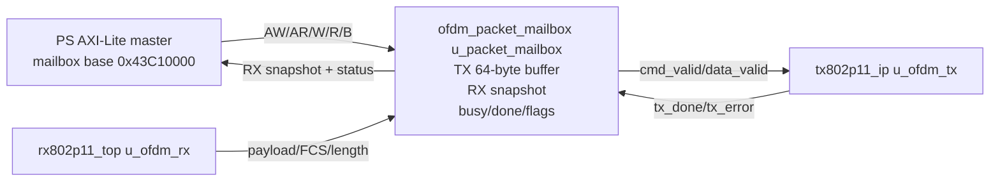

# 系统模块级数据流程图

本图按当前 RTL 顶层实例和固件调用关系绘制，重点展示**模块名称、实例名称、接口名称和数据方向**。主数据链路从左到右：主机/PS 发射 → PL TX → AD936x 射频回环 → PL RX → PS/主机接收。控制、状态、ACK 和失败路径使用虚线表示，不与主数据流混淆。

## 1. 单板 DMA 模式完整数据流

```mermaid
flowchart LR
    %% ================================================================
    %% Host and PS software
    %% ================================================================
    subgraph HOST[Host 主机]
        HFILE[用户数据/图像文件]
        HUART[host/dma_uart.py\nUART 115200 8N1]
        HTCP[host/dma_image.py\nTCP port 5001]
        HPACKET[OF packet\n24-byte header + 1..1000-byte payload]
        HVERIFY[匹配 session/message\n重组 RX 分片\nCRC32 + 逐字节比较]
        HPASS[LOOPBACK PASS\n保存 returned file\nSHA-256]
        HFAIL[FAIL / timeout / CRC mismatch]
    end

    subgraph PS[Zynq PS 软件与 DDR]
        SVC[services.c\nservices_init()\nservices_poll()]
        UARTS[uart_service()]
        TCPS[tcp_service()\ntcp_accept_client()]
        LINKIN[link_validate()\nlink_enqueue()]
        LINKPOLL[link_poll()\nACK 优先 / 重试 / 去重]
        DMASEND[dma_transport_send()\n构造 16-byte local metadata\nTX BD + cache flush]
        DDRTX[DDR TX buffer\ntx_data[128][2048]]
        AXIDMA[AXI DMA\nSG TX/RX rings\n128 descriptors]
        DDRRX[DDR RX buffer\nrx_data[128][2048]]
        DMAPOLL[dma_transport_poll()\nBD status / cache invalidate]
        DELIVER[link_receive()\nservices_deliver()]
        IMAGE[图像 bitmap / image buffer\nCRC32 / OS status record]
        TCPUARTOUT[TCP/UART 返回\nRX packet / ACK / OS status]
    end

    %% ================================================================
    %% PL top level and DMA path
    %% ================================================================
    subgraph PLDMA[PL：ad936x_ofdm_TOP / DMA 分支]
        CTRL[ofdm_dma_control u_control\nAXI-Lite registers\nenable + counters]
        AXISTX[s_axis_tx\nTDATA/TVALID/TLAST/TREADY]
        DMATX[ofdm_dma_tx u_dma_tx\n4 BRAM packet slots\nmetadata parser / FIFO]
        TXCMD[cmd_valid/cmd_ready\ncmd_length/cmd_rate/cmd_upsample]
        TXDATA[data_valid/data_ready/data_last\ndata_byte]
        DMARX[ofdm_dma_rx u_dma_rx\nstore-before-commit\n8 RX BRAM slots]
        AXIRX[m_axis_rx\nTDATA/TVALID/TLAST/TREADY]
    end

    %% ================================================================
    %% TX PHY
    %% ================================================================
    subgraph TXPHY[PL：OFDM TX PHY]
        TXIP[tx802p11_ip u_ofdm_tx\npacket capture/replay\nrate validation / 32768-cycle guard]
        TXCORE[Tx802p11\nOFDM TX core]
        TXCRC[crc32 u_crc32\n用户字节 + CRC32]
        TXRS[rs_packet_encoder u_rs\nRS(255,239)\nINTERLEAVE=RS_INTERLEAVE]
        TXGEN[tx_generate_data u_tx_generate_data\nPSDU bytes -> data bits]
        TXSCR[scramble_lc u_scramble_lc]
        TXCONV[tx_conv_encoder u_tx_conv_encoder]
        TXPUNC[tx_puncture u_tx_puncture\nR1/2, R2/3, R3/4]
        TXINT[tx_interleaver u_tx_interleaver]
        TXMOD[tx_modulate u_tx_modulate0\nBPSK/QPSK/16QAM/64QAM]
        TXFFTQ[tx_fft_input_queue u_fft_input_queue]
        TXIFFT[xfft_tx_freqd_to_timed u_shared_ifft\n频域 -> 时域]
        TXSIG[tx_gen_sig u_tx_gen_sig\nSIGNAL / preamble]
        TXCP[tx_freqd_to_timed u_tx_freqd_to_timed\ncyclic prefix]
        TXARR[tx_out_arrange u_tx_out_arrange\nI/Q sample stream]
    end

    %% ================================================================
    %% AD936x and RF loopback
    %% ================================================================
    subgraph RF[AD936x 数字接口与射频路径（ad936x_phy_TOP u_phy）]
        SCALE_TX[ofdm_iq_scale u_iq_scale\nTX 输出：16-bit PHY -> 12-bit I/Q]
        PHYTX[ad936x_phy_tx u_ad936x_phy_tx\nTX LVDS serializer]
        ANT[AD936x TX/RX\n外部天线/线缆/衰减器回环]
        PHYRX[ad936x_phy_rx u_ad936x_phy_rx\nRX LVDS deserializer]
        SCALE_RX[ofdm_iq_scale u_iq_scale\nRX 输入：12-bit I/Q -> 16-bit PHY]
    end

    %% ================================================================
    %% RX PHY
    %% ================================================================
    subgraph RXPHY[PL：OFDM RX PHY]
        RXTOP[rx802p11_top u_ofdm_rx]
        RXSHORT[sync_short_packet_detect\nu_sync_short_packet_detect\n短前导检测]
        RXCOARSE[rx_coarse_cfo_use_st\nu_rx_coarse_cfo_use_st\n粗频偏校正]
        RXLONG[rx_sync_long_packet_detect\nu_rx_sync_long_packet_detect\n长前导/对齐]
        RXFINE[rx_fine_cfo_correct_use_lt\nu_rx_fine_cfo_correct_use_lt\n细频偏校正]
        RXFFT[rx_timed_to_freqd\nu_rx_timed_to_freqd\n去 CP + FFT]
        RXCH[rx_estimate_channel_info\nu_rx_estimate_channel_info\n信道估计/平滑]
        RXPILOT[rx_phase_tracker_correct_use_pilot\nu_rx_phase_tracker_correct_use_pilot]
        RXDEMOD[bpsk_demodulation / ofdm_data_frontend\nQAM 判决与数据前端]
        RXDEINT[bpsk_deinterleaver\nu_bpsk_deinterleaver\nOFDM bit deinterleave]
        RXVIT[viterbi_decoders\nu_bpsk_data_viterbi_decoders\n卷积码译码]
        RXDESC[qam64_descramble\nu_qam64_descramble\n解扰/字节流输出]
        RXRS[rs_packet_decoder u_rs\n去交织 + BM/Chien/Forney\nRS correction]
        RXFCS[fcs_for_data_field\nu_fcs_for_data_field\nFCS/CRC32]
        RXSIG[recv_data_finished_control\nu_recv_data_finished_control\npacket_start / frame done]
    end

    %% ================================================================
    %% Main TX data path
    %% ================================================================
    HFILE --> HUART
    HFILE --> HTCP
    HUART --> HPACKET
    HTCP --> HPACKET
    HPACKET --> SVC
    SVC --> UARTS
    SVC --> TCPS
    UARTS --> LINKIN
    TCPS --> LINKIN
    LINKIN --> LINKPOLL --> DMASEND --> DDRTX --> AXIDMA
    AXIDMA -->|MM2S AXIS| AXISTX --> DMATX
    DMATX --> TXCMD --> TXIP
    DMATX --> TXDATA --> TXIP
    TXIP --> TXCORE
    TXCORE --> TXCRC --> TXRS --> TXGEN --> TXSCR --> TXCONV --> TXPUNC --> TXINT --> TXMOD --> TXFFTQ --> TXIFFT --> TXCP --> TXARR --> SCALE
    TXSIG --> TXARR
    TXMOD --> TXSIG
    TXARR --> SCALE_TX --> PHYTX --> ANT

    %% ================================================================
    %% RF and RX data path
    %% ================================================================
    ANT --> PHYRX --> SCALE_RX --> RXTOP
    RXTOP --> RXSHORT --> RXCOARSE --> RXLONG --> RXFINE --> RXFFT --> RXCH --> RXPILOT --> RXDEMOD --> RXDEINT --> RXVIT --> RXDESC --> RXRS --> RXFCS
    RXSIG --> RXTOP
    RXFCS -->|fcs_data_out_valid + fcs_ok + pkt_length| DMARX
    RXTOP -->|packet_start| DMARX
    DMARX -->|accepted packet only| AXIRX -->|S2MM AXIS| AXIDMA --> DDRRX --> DMAPOLL --> DELIVER
    DELIVER --> IMAGE --> TCPUARTOUT --> HVERIFY --> HPASS
    HVERIFY --> HFAIL

    %% ================================================================
    %% Control/status paths, drawn separately from payload flow
    %% ================================================================
    CTRL -.AXI-Lite enable / counters.-> DMATX
    CTRL -.AXI-Lite enable / counters.-> DMARX
    DMATX -.submitted/completed/rejected/failed.-> CTRL
    DMARX -.accepted/dropped/overflow/timeout.-> CTRL
    DMATX -.tx_done / tx_error / phy_reset.-> TXIP
    TXIP -.done / error.-> DMATX
    DMAPOLL -.RX DMA status.-> SVC
    DELIVER -.ACK record / duplicate suppression.-> LINKPOLL
    LINKPOLL -.retry limit / failure status.-> TCPUARTOUT

    classDef software fill:#d9eaf7,stroke:#2f75b5,color:#111;
    classDef dma fill:#e2f0d9,stroke:#548235,color:#111;
    classDef tx fill:#fce4d6,stroke:#c65911,color:#111;
    classDef rf fill:#e4dfec,stroke:#7030a0,color:#111;
    classDef rx fill:#fff2cc,stroke:#b8860b,color:#111;
    classDef verify fill:#d9ead3,stroke:#38761d,color:#111;
    class HFILE,HUART,HTCP,HPACKET,HVERIFY,HPASS,HFAIL,SVC,UARTS,TCPS,LINKIN,LINKPOLL,DMASEND,DDRTX,AXIDMA,DDRRX,DMAPOLL,DELIVER,IMAGE,TCPUARTOUT software;
    class CTRL,AXISTX,DMATX,TXCMD,TXDATA,DMARX,AXIRX dma;
    class TXIP,TXCORE,TXCRC,TXRS,TXGEN,TXSCR,TXCONV,TXPUNC,TXINT,TXMOD,TXFFTQ,TXIFFT,TXSIG,TXCP,TXARR tx;
    class SCALE_TX,PHYTX,ANT,PHYRX,SCALE_RX rf;
    class RXTOP,RXSHORT,RXCOARSE,RXLONG,RXFINE,RXFFT,RXCH,RXPILOT,RXDEMOD,RXDEINT,RXVIT,RXDESC,RXRS,RXFCS,RXSIG rx;
    class HVERIFY,HPASS,HFAIL,IMAGE verify;
```

## 2. 模块与数据方向对照

| 方向 | 上游 | 接口/数据 | 下游 | 源码依据 |
|---|---|---|---|---|
| PS → PL TX | `XAxiDma` TX ring | AXI-Stream，16 字节本地元数据 + 无线包 | `ofdm_dma_tx u_dma_tx` | `rtl/board/ad936x_ofdm_TOP.v`、`ofdm_dma_tx.v` |
| PL TX 包适配 | `ofdm_dma_tx` | `cmd_*`、`data_*` | `tx802p11_ip u_ofdm_tx` | `rtl/board/ad936x_ofdm_TOP.v` |
| TX PHY | `tx802p11_ip` | 用户字节与命令 | `Tx802p11` | `rtl/ofdm/tx/tx802p11_ip.v` |
| TX 波形 | `Tx802p11` | 16-bit `m_re/m_im` | `ofdm_iq_scale` | `rtl/board/ad936x_ofdm_TOP.v` |
| AD936x TX | `ofdm_iq_scale` | 12-bit I/Q channel 1 | `ad936x_phy_tx` | `rtl/board/ad936x_phy_TOP.v` |
| AD936x RX | `ad936x_phy_rx` | 12-bit I/Q channel 1 | `ofdm_iq_scale` | `rtl/board/ad936x_phy_TOP.v` |
| RX PHY | `ofdm_iq_scale` | 16-bit I/Q sample | `rx802p11_top` | `rtl/board/ad936x_ofdm_TOP.v` |
| RX 包提交 | `rx802p11_top` | `packet_start`、payload、FCS、长度 | `ofdm_dma_rx u_dma_rx` | `rtl/board/ad936x_ofdm_TOP.v` |
| PL → PS RX | `ofdm_dma_rx` | AXI-Stream，完整包才输出 | `XAxiDma` RX ring | `rtl/board/ofdm_dma_rx.v`、`dma_transport.c` |
| PS → Host | `dma_transport_poll`/`services_deliver` | UART/TCP record、ACK、OS status | 主机客户端 | `firmware/dma_app/services.c`、`host/dma_image.py` |

## 3. mailbox 模式替代入口

当 `ad936x_ofdm_TOP` 的参数 `DMA_ENABLE=0` 时，AXI-Stream DMA 分支被替换为 `ofdm_packet_mailbox u_packet_mailbox`：



mailbox 是单个 64 字节事务的 AXI-Lite 数据面，不是 SG-DMA 的替代软件协议；它与 DMA 分支共用 `tx802p11_ip`、`ofdm_iq_scale`、`rx802p11_top` 和 `ad936x_phy_TOP`，但不经过 `ofdm_dma_tx/ofdm_dma_rx` 的 AXI-Stream 包队列。

## 4. 处理链说明

- **TX 字节路径：** `crc32 → rs_packet_encoder → tx_generate_data → scramble_lc → tx_conv_encoder → tx_puncture → tx_interleaver → tx_modulate → tx_fft_input_queue/xfft_tx_freqd_to_timed → tx_gen_sig/tx_freqd_to_timed → tx_out_arrange`。
- **RX 样本路径：** `sync_short_packet_detect → rx_coarse_cfo_use_st → rx_sync_long_packet_detect → rx_fine_cfo_correct_use_lt → rx_timed_to_freqd → rx_estimate_channel_info → rx_phase_tracker_correct_use_pilot → bpsk_demodulation/ofdm_data_frontend → bpsk_deinterleaver → viterbi_decoders → qam64_descramble → rs_packet_decoder → fcs_for_data_field`。
- **真实数据提交边界：** `ofdm_dma_rx` 在 `fcs_strobe` 到达时检查 `fcs_ok`、接收长度、最大 1024 字节和 RX slot；通过后才增加 `accepted` 并向 `m_axis_rx` 输出。
- **失败数据走向：** TX 非法元数据进入 `rejected`；TX PHY 错误或超时进入 `failed`/恢复复位；RX FCS/长度/slot/超时错误进入 `dropped`、`overflow` 或 `timed_out`，不会进入 PS RX DMA 数据流。
